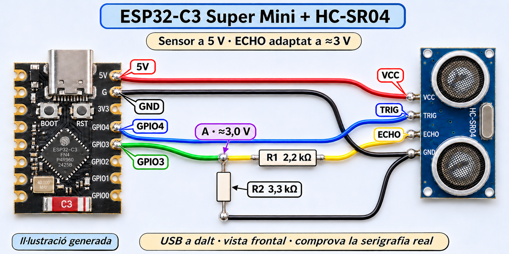

**Guia ràpida i QR del dispositiu:** [https://jrevelldev.github.io/esp32-ultrasonic-touchdesigner/comenca.html](https://jrevelldev.github.io/esp32-ultrasonic-touchdesigner/comenca.html) · [QR imprimible A6](https://jrevelldev.github.io/esp32-ultrasonic-touchdesigner/assets/qr-guia-imprimible.pdf)

# Distància · ESP32-C3 × TouchDesigner

Un dispositiu amb configuració Wi-Fi des del mòbil, web local, LED d’estat i enviament de distàncies per OSC a TouchDesigner.

**[Obre la guia interactiva →](https://jrevelldev.github.io/esp32-ultrasonic-touchdesigner/)**

La guia està en català, té deu passos, progrés desat al navegador, il·lustracions ampliables, codi complet per copiar i descàrregues. La publicació depèn que GitHub Pages estigui activat al repositori; consulta [PUBLICACIO.md](PUBLICACIO.md).



## Estat real del projecte

| Part | Estat |
| --- | --- |
| Configuració Wi-Fi, IP automàtica/fixa i persistència | Provades en una ESP32-C3 Super Mini |
| Nom Wi-Fi individual, BOOT i LED | Provats |
| Web local i OSC per Wi-Fi a TouchDesigner | Provats amb dades simulades |
| Valors manuals de 42 i 155 cm rebuts a TouchDesigner | Comprovats |
| Cablejat HC-SR04 i divisor d’ECHO | Muntat per l’usuari; primera lectura física vàlida |
| Lectura real del HC-SR04 | Implementada en 1.1.0, amb ecos físics vàlids rebuts |

El firmware **1.2.2 arrenca amb el sensor real** (TRIG GPIO4, ECHO GPIO3). A la web pots seleccionar també simulació automàtica o manual. Si no hi ha eco vàlid, envia `/sensor/valid = 0`, distància OSC −1 i distància JSON `null`; no presenta una lectura antiga com a vigent. Vegeu [VALIDACIO.md](VALIDACIO.md).

## Setup des de zero

1. **Material de la prova:** ESP32-C3 Super Mini, cable USB-C de dades, ordinador, mòbil i Wi-Fi de 2,4 GHz. No cal connectar el sensor per comprovar la comunicació.
2. Instal·la [Arduino IDE 2](https://www.arduino.cc/en/software/). Al Mac, arrossega’l a Aplicacions.
3. A **Arduino IDE → Settings… → Additional boards manager URLs**, afegeix:

   ```text
   https://espressif.github.io/arduino-esp32/package_esp32_index.json
   ```

4. A **Boards Manager**, busca **esp32** i instal·la **esp32 by Espressif Systems**. Versions de la prova: Arduino IDE **2.3.10**, paquet ESP32 **3.3.12**. Són una referència validada, no una afirmació que siguin les versions més recents.
5. Selecciona **ESP32C3 Dev Module**, el port USB de la placa i **Tools → USB CDC On Boot → Enabled**. «ESP32 Dev Module» correspon a un altre xip.
6. **No cal instal·lar biblioteques addicionals.** WiFi, WebServer, DNSServer, Preferences, WiFiUdp i esp_mac.h venen amb el paquet ESP32. La versió actual no utilitza WiFiManager.
7. Obre [ESP32_OSC_Demo.ino](firmware/ESP32_OSC_Demo/ESP32_OSC_Demo.ino), prem **Verify** i **Upload**. El fitxer ha d’estar dins una carpeta anomenada `ESP32_OSC_Demo`.
8. Obre **Serial Monitor a 115200 baud** i prem RESET amb BOOT alliberat. Anota el nom `ESP-Config-…`.
9. Des del mòbil, connecta’t a aquest Wi-Fi amb la clau **Configura32**. Accepta continuar sense Internet. Obre **http://192.168.4.1** si el portal no apareix sol.
10. Tria la xarxa de casa i escriu-ne la contrasenya. **Deixa la IP fixa buida a la primera connexió** per obtenir els valors correctes amb DHCP. Desa i anota la IP de l’ESP.
11. Torna al Wi-Fi de casa i obre `http://IP-DE-L-ESP`. Aquesta és la web de la prova. `192.168.4.1` només és l’adreça del portal quan estàs connectat al Wi-Fi temporal de la placa.
12. Instal·la [TouchDesigner](https://derivative.ca/download) i obre [el projecte .toe](touchdesigner/Prova_ESP32_TouchDesigner.toe). La prova es va fer amb **2025.32460**. També hi ha [el component .tox](touchdesigner/Prova_ESP32_TouchDesigner.tox) per importar en un altre projecte.
13. Consulta la **IP de l’ordinador**. A la web de l’ESP, a **TouchDesigner · OSC**, desa aquesta IP i el port **9000**. El camp està buit inicialment en aquesta edició reutilitzable; no cal editar el codi.
14. Dins `/project1/esp32_demo`, comprova `osc_in`: **Network Port = 9000**, **Active = On**. Permet TouchDesigner al tallafoc si ho demana.
15. A la web, selecciona **Simulació manual** a **Font de la distància**, posa **42 cm** i aplica. TouchDesigner ha de mostrar 42 i una proximitat aproximada de 0,878. Amb 155 cm, la proximitat serà 0,25. Tria Simulació automàtica per veure el moviment o Sensor real per llegir el HC-SR04 físic.

La instal·lació oficial del paquet està documentada a [Espressif](https://docs.espressif.com/projects/arduino-esp32/en/latest/installing.html); el receptor està documentat a [OSC In CHOP](https://docs.derivative.ca/OSC_In_CHOP).

## Configuració diària

- **BOOT durant 5 segons i deixa’l anar:** obre la configuració. El parpelleig molt ràpid indica quan el pots deixar anar.
- **LED fix:** connectat, portal tancat. Lent: connectant. Regular: configuració oberta.
- **RESET:** reinicia sense esborrar els ajustos. La font torna al sensor real.
- **IP fixa:** connecta primer amb DHCP i reobre el portal; s’ompliran porta d’enllaç, màscara i DNS amb els valors reals. Tria una IP lliure i reserva-la o exclou-la del rang DHCP del router. També pots mantenir DHCP i fer la reserva només al router.
- **Diverses plaques:** el nom `ESP-Config-<MAC completa>` és estable i individual. Assigna una IP diferent a cada ESP i ports OSC diferents (9000, 9001, …), cadascun amb el seu OSC In CHOP. Els noms dels missatges `/sensor/…` són compartits.

Un enviament per mesura: interval configurable de 70 a 1000 ms (100 ms per defecte; 70 ms dona aproximadament 13–14 Hz). Missatges: `/sensor/distancia` (float cm), `/sensor/proximitat` (float 0–1), `/sensor/simulat` (int: 0 real, 1 simulat), `/sensor/valid` (int: 1 vàlid, 0 sense eco) i `/sensor/seq` (int comptador). La web també exposa `/telemetry` en JSON.

## Sensor i soldadura

**Il·lustració actualitzada segons les referències de la placa i del sensor.** Amb l’USB a dalt i mirant la cara amb components, els pins del costat dret són 5V, GND, 3V3, GPIO4, GPIO3, GPIO2, GPIO1 i GPIO0. A la cara posterior apareixen a l’esquerra. Comprova sempre la serigrafia real. Les fotos de referència són a [hardware/referencies](hardware/referencies/).

| HC-SR04 de 5 V | ESP32-C3 |
| --- | --- |
| VCC | 5V, amb alimentació USB |
| GND | G/GND comú |
| TRIG | GPIO4 directe |
| ECHO | R1 de 2,2 kΩ → punt A → GPIO3 |
| Punt A | R2 de 3,3 kΩ → GND |

El divisor deixa aproximadament **3 V** al GPIO3. **ECHO de 5 V no es connecta directament al GPIO.** Munta i solda sense alimentació, comprova curtcircuits i aïlla les unions. [Guia completa de soldadura](hardware/GUIA_SOLDADURA.md) · [Esquema funcional](hardware/esquema.svg) · [Il·lustració del corrent](docs/assets/corrent-divisor.svg).

### Per què mantenim 5 V i les dues resistències?

La referència mostra un HC-SR04 estàndard, no una variant certificada per funcionar a 3,3 V. El mantenim alimentat a 5 V: TRIG accepta l’impuls de 3,3 V de l’ESP, mentre que ECHO necessita el divisor de 2,2 kΩ / 3,3 kΩ. Alimentar un HC-SR04 estàndard a 3,3 V pot donar resultats poc fiables. [Referència d’Adafruit](https://learn.adafruit.com/distance-measurement-ultrasound-hcsr04/connect-the-sensor).

Per eliminar el divisor cal un mòdul amb alimentació i ECHO documentats per a 3,3 V, com un [US-100](https://www.adafruit.com/product/4019) alimentat a 3,3 V en mode TRIG/ECHO (jumper posterior retirat). No és el sensor que mostren aquestes fotos. Si ECHO fos realment de 3,3 V, el divisor actual el reduiria a 1,98 V: no el conservis en aquell muntatge.

## Què hi ha al repositori

```text
firmware/       Programa complet 1.2.2: sensor real i simulació seleccionable
touchdesigner/  Projecte .toe i component .tox validats
hardware/       Esquema funcional i guia de soldadura
docs/           Web estàtica per a GitHub Pages i descàrregues
archive/        Versions i resultats històrics de la primera prova
tools/          Preparació i comprovació de les descàrregues
```

`archive/` conserva la primera prova amb les seves adreces de xarxa d’exemple. No són valors per copiar a una altra xarxa. El firmware actiu és a `firmware/`, no a `archive/`.

## Editar o veure la guia al teu ordinador

La web no necessita Node, npm ni cap servei extern. Des de l’arrel del repositori, amb Python 3 instal·lat:

```sh
python3 tools/prepare_downloads.py
python3 tools/check_site.py
python3 -m http.server 8765 --directory docs
```

Obre **http://localhost:8765**. És preferible servir-la així en lloc de fer doble clic a `index.html`, perquè la càrrega del codi complet utilitza `fetch`.

Quan canviïs firmware o fitxers descarregables, torna a executar `prepare_downloads.py`. La publicació de Pages també els regenera automàticament. Consulta [PUBLICACIO.md](PUBLICACIO.md).

## Versió 1.1.0 · sensor connectat

A la web, tria **Sensor real · HC-SR04** i prem **Aplica font de dades**. Comprova la resposta amb un objecte pla a 20–50 cm. El desplegable no modifica la configuració Wi-Fi ni OSC. La simulació continua disponible per comprovar TouchDesigner sense sensor; després d’un reinici sempre s’activa el sensor real.

La proximitat continua normalitzada entre 20 i 200 cm. Una distància real superior a 200 cm és vàlida fins a 400 cm però dona proximitat 0; per sota de 20 cm dona 1.

Alternativa per al divisor quan disposes d’aquest material: **R1 = 2k2** i, d’A a GND, **2k2 + 1k5 en sèrie = 3k7**. Amb ECHO a 5 V, A queda aproximadament a 3,14 V. La il·lustració principal manté l’altra combinació vàlida de 2k2/3k3.

Per obtenir els controls visuals i el visor del component, descarrega el `.toe` o el `.tox` actual. El script `touchdesigner/Actualitza_sensor_real.py` queda com a utilitat per a projectes antics i només actualitza les etiquetes i els canals bàsics.

## Versió 1.2.0 · raw, suavitzat i ritme

A la web de l’ESP obre **Lectura i suavitzat**. Tria interval (70–1000 ms), sortida **Raw** o **EMA**, i alpha (0,01–1). Alpha més petit suavitza més però introdueix retard. Els ajustos es desen a la placa. El HC-SR04 necessita més de 60 ms entre impulsos: no genera 60 mesures noves/s encara que TD treballi a 60 FPS. La web consulta les dades cada 100 ms.

| Canal OSC | Significat |
| --- | --- |
| `/sensor/raw` | Distància sense filtre, en cm |
| `/sensor/filtrada` | EMA en cm; igual a raw si el filtre està desactivat |
| `/sensor/distancia` | Sortida seleccionada: raw o EMA |
| `/sensor/echo_us` | Durada física d’ECHO, en µs; 0 sense eco o en simulació |
| `/sensor/interval_ms` | Interval real entre inicis de mesura |
| `/sensor/timestamp_ms` | Temps de la mostra des de l’arrencada, en ms |

Les dades de distància invàlides valen −1 per OSC i `null` en JSON: consulta sempre `/sensor/valid`. La dada raw en cm ja es rebia sense filtre a la versió 1.1; els microsegons permeten veure també la mesura anterior a la conversió. Més freqüència no augmenta la precisió física del sensor.

En el projecte TD: **raw_cm** → dada directa, **filtrada_esp_cm** → sortida del filtre a la placa, **suavitzat_td** → suavitzat de la bola ajustable amb **Smoothing (s)** al component `esp32_demo`. El panell principal continua mostrant `/sensor/distancia`. **validesa** indica si la dada es pot utilitzar. Tria Raw a l’ESP si filtres a TD. [Documentació de Lag CHOP](https://derivative.ca/UserGuide/Lag_CHOP).

La revisió **1.2.1** evita pauses provocades per diagnòstics USB quan el monitor no llegeix i limita la web a una sola consulta en curs. Si la connexió triga, ho indica en lloc de deixar dades aparentment actuals.

## Release 1.2.2 · descarregar TD des del sensor

A la web del sensor, sota **TouchDesigner · OSC**, el botó **Descarrega el patch de TouchDesigner** obre [la release v1.2.2](https://github.com/jrevelldev/esp32-ultrasonic-touchdesigner/releases/tag/v1.2.2). Inclou el projecte .toe complet, el component .tox i el firmware font en ZIP. Cal Internet per obrir GitHub; no és una actualització automàtica de la placa.

La bola es configura visualment a **Ball Controls**: Near/Far en cm, radi petit/gran, Smoothing i Near makes large. Sense eco vàlid, sempre pren l’estat «lluny». El node exterior `esp32_demo` mostra la lectura i el cercle. Els canals raw continuen disponibles.
